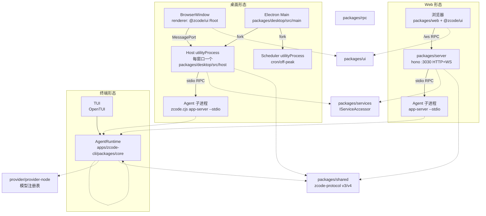
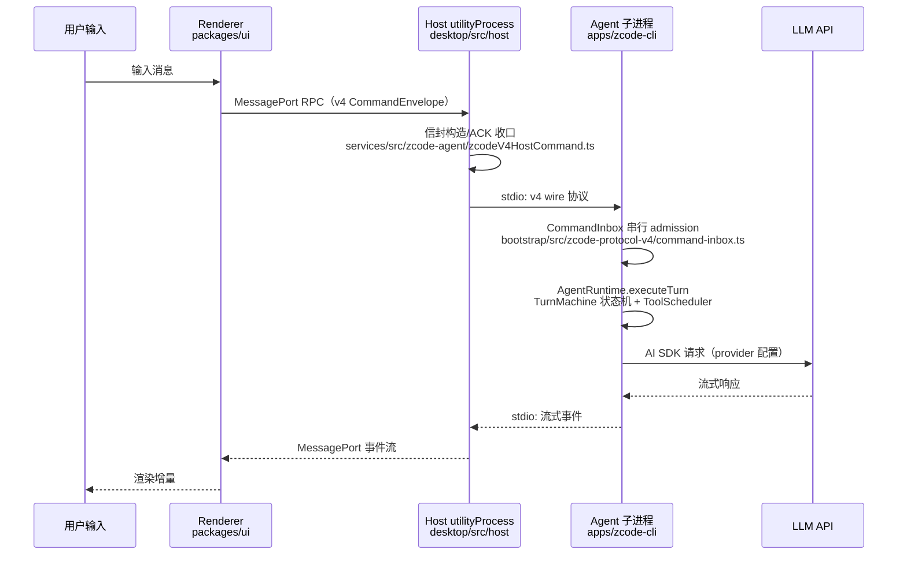

# 00 项目概览

## 1. 项目是什么

**Ycode**（v3.14.3，Apache-2.0）是一个 AI 编程工作台，同一套代码提供三种交付形态：

| 形态 | 载体 | 启动方式 |
| --- | --- | --- |
| 桌面应用 | Electron（`packages/desktop`） | `pnpm dev:desktop` / 打包安装 |
| 浏览器界面 | Web（`packages/web` + `packages/server`） | `pnpm dev:web` 或 `zcode --web` |
| 终端 Agent | TUI/CLI（`apps/zcode-cli`） | `zcode`（无参数进入 TUI） |

三形态共享同一 Agent 运行时、同一协议、同一 UI 组件库。本仓库是上游 ZCode 的开源化分支（rebrand spec 见 `specs/ycode-rebrand.md`：移除官方遥测、移除内置供应商账号链、移除启动强更检查；2026-09-26 已合入上游 v3.14.3，见 `memory/ycode-main-v3143-merge.md`）。

## 2. 技术栈（现状事实）

| 层 | 技术 | 证据 |
| --- | --- | --- |
| 语言/运行时 | TypeScript 6（ESM）、Node.js 24.14.0、target es2024 | `package.json:79-80`、`mise.toml`、`tsconfig.base.json` |
| 包管理 | pnpm 10.33.2 workspace + turbo（CLI 子仓） | `pnpm-workspace.yaml`、`apps/zcode-cli/turbo.json` |
| 桌面 | Electron 26.x（electron-builder）、utilityProcess、MessagePort | `packages/desktop/electron-builder.config.js` |
| 服务端 | hono + @hono/node-server + ws | `packages/server/package.json` |
| 前端 | React 19 + Vite 8（rolldown）+ Tailwind 4 + Zustand | `packages/web/vite.config.ts`、`packages/ui/src/store/` |
| 终端 UI | OpenTUI（`@mbears/opentui-react`，非 ink） | `apps/zcode-cli/packages/tui/src/tui.tsx` |
| LLM 接入 | Vercel AI SDK（`@ai-sdk/anthropic`、`@ai-sdk/openai-compatible`，均有本地 patch） | 根 `package.json:88-91`、`patches/` |
| 持久化 | SQLite（会话存储）、文件系统（配置/记忆/插件） | `apps/zcode-cli/packages/adapters/src/storage/session-store.ts` |
| RPC | 自研 7 层 VS Code 风格 IPC 框架 | `packages/rpc/src/index.ts` 头注释 |
| 校验 | zod（协议 schema） | `packages/shared/src/zcode-protocol/index.ts` |
| 质量 | oxlint + oxfmt + 自研架构检查 + knip；测试用 node:test（仅 6 个文件） | `package.json:37-47`、`.architecture-baseline.json` |
| 遥测 | OpenTelemetry OTLP（可选启用，采样 0.1） | `apps/zcode-cli/packages/telemetry/src/otlp-exporter.ts` |
| 工具链 | mise 固定版本 | `mise.toml` |

## 3. 顶层目录结构

```
ZCode/
├── apps/zcode-cli/          # Agent CLI 与运行时（独立 pnpm+turbo 子仓，16 个子包）
├── packages/
│   ├── desktop/             # Electron：main / host / preload / renderer / scheduler
│   ├── server/              # hono HTTP+WS 服务端（Web 宿主 + 远程后端）
│   ├── zcode-server-cli/    # server 守护进程 CLI（supervisor、系统服务注册、在线更新）
│   ├── web/                 # Web 宿主薄壳（React，复用 @zcode/ui）
│   ├── ui/                  # 共享 React 组件库 + Zustand store（609 tsx，源码直出）
│   ├── services/            # 业务服务集合（IServiceAccessor，40+ 子域）
│   ├── client/              # Agent 客户端 SDK（WS/MessagePort → RPC socket）
│   ├── rpc/                 # 7 层 IPC/RPC 框架（VS Code 风格）
│   ├── shared/              # 共享协议与类型（zcode-protocol v3 + v4、IPlatformService）
│   ├── provider/            # 模型/提供商配置注册表（环境无关）
│   ├── provider-node/       # provider 运行时物化（Node 侧）
│   ├── zcode-cua/           # Computer Use 占位包（fail-closed，无 src）
│   ├── formal-proof/        # 会话状态机形式化审查可视化（D3 独立应用）
│   └── model-option-map/    # per-model 请求体改写 DSL 编译器
├── scripts/                 # bootstrap/构建/打包/架构检查/原生搜索工具等 40+ 脚本
├── config/                  # 客户端内置默认配置（default.json、provider/zcode-builtin.json）
├── specs/                   # 关键操作的 spec 文档（merge、rebrand）
├── memory/ + MEMORY.md      # 项目长期记忆（agent 召回用）
├── .agents/skills/          # 8 个 agent 技能（架构治理、浏览器自动化等）
├── architecture-policy.yaml # 架构治理策略（14+ 模块声明）
├── harness/remote/          # 远程 SSH 测试容器（Dockerfile）
├── third-party/             # 第三方合规清单
├── patches/                 # 2 个 pnpm patch（ai-sdk 视频输入支持）
└── AGENTS.md / DESIGN.md / CONTEXT.md / README.md
```

## 4. 整体架构图



三形态的汇合点是 **Agent 运行时 + 协议**：桌面 Host、Web server、TUI 都是与同一个 `AgentRuntime` 对话的不同前端。

## 5. 核心数据流

### 5.1 用户消息 → Agent 响应（桌面端，现状事实）



- 已接的 busy/running 输入由 CLI 侧 `CommandInbox` 串行 admission（CAS guard：revision + logEpoch，见 `packages/shared/src/zcode-protocol-v4/command.ts` 的 `COMMANDS_REQUIRING_BASE_REVISION`）；Renderer 只保留未提交草稿与 pending optimistic overlay。
- 实时流（`desktop-continuous`，桌面直连）与恢复流（`web-remote-replayable`，手机/远控可重放）是两条必须分别验证的语义链路（`packages/desktop/src/main/taskRealtimeBus.ts` 拥有 lease/stream batching/replay 状态）。

### 5.2 工具执行流（现状事实）

Agent 决定调用工具 → `ToolRegistryImpl` 查找 handler → `ToolScheduler` 按依赖拓扑与只读性分组并行（默认并发 10，`apps/zcode-cli/packages/core/src/tool/scheduler.ts`）→ 有副作用的工具先经 `PermissionService`（allow/ask/deny）→ `tool/executor/impl.ts` 执行 → 大结果落盘只回摘要 → 结果聚合回 turn 状态机。

### 5.3 持久化（现状事实）

| 数据 | 所有者 | 位置 |
| --- | --- | --- |
| 会话/消息/checkpoint | Agent 进程 | SQLite：`adapters/src/storage/session-store.ts`（`getDefaultSessionDbPath()`） |
| 任务索引 | Host services | `services/src/session/taskIndexRepo`（SQLite） |
| 设置 | desktop-settings owner | `services/src/storage/`（hexagonal 分层） |
| 配置/记忆/插件 | Agent/宿主各管一层 | `~/.zcode/` 目录族、`ZCODE_DATA_BASE_DIR` 可重定向 |
| 远程组件缓存 | Main | `userData/remote-assets-cache`（`desktop/src/main/desktopRuntimeEnv.ts:291`） |

## 6. 一句话定位每个"非主流"包

- `zcode-cua`：Computer Use 的**编译后占位包**，所有运行面报告 unavailable 并 fail-closed（其 README 自述）；权限代理实现在 `packages/services/src/cua-permission-broker/`。
- `formal-proof`：对 Agent 会话排队/compact/goal 验证逻辑做**形式化状态机审查**的 D3 可视化沙盘，独立 Vite 应用。
- `model-option-map`：把 per-model 的请求体改写规则（推理档位、max output tokens）编译成可复用程序的 **mini DSL 编译器**（JSON Merge Patch）。
