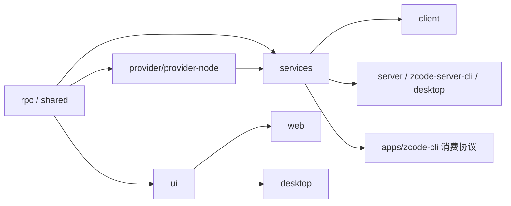

# 01 模块清单

> 每个模块按：职责 / 关键文件与符号 / 依赖 / 被依赖 / 备注 组织。除特别标注"推断"外均为现状事实。路径均相对仓库根。

## 总依赖方向（现状事实 + 推断）

依赖规则：`@zcode/*` 包间通过 workspace 包名解析（`tsconfig.base.json` **无 paths 别名**）；跨包只允许走公开入口（`architecture-policy.yaml` 声明，当前仅 storage 强制执行，见 04）。

---

## 1. packages/desktop — Electron 桌面端

| 项 | 内容 |
| --- | --- |
| 职责 | 窗口/托盘/菜单、每窗口派生 Host utilityProcess、远程会话管理、内嵌浏览器（BrowserView）、自动更新、cron 调度派发、打包 |
| 入口 | `src/main/index.ts`（2106 行；`out/main/index.js` 为 package.json main） |
| 分层 | `src/main`（~149 文件）/ `src/host`（~37）/ `src/preload`（6，CJS）/ `src/renderer`（薄壳，挂载 `@zcode/ui` 的 `Root`）/ `src/scheduler`（3） |
| 关键符号 | `createWindowInstance()`（`src/main/index.ts:1515`）、`spawnHostProcess()`（`src/main/desktopHostProcess.ts:165`，MessageChannelMain 双 port 分发）、`createBrowserWindow()`（`src/main/desktopWindowChrome.ts:364`）、`createWindowHostAttachmentRegistry()`（`src/host/windowHostAttachmentRegistry.ts`）、`createWindowHostControllerRuntime()`（`src/host/windowHostControllerService.ts:137`）、`windowRemoteConnectionRegistry`（远端连接唯一 owner，`src/host/index.ts:1383` 实例化）、`taskRealtimeBus`（lease/owner/stream replay 状态所有者，`src/main/taskRealtimeBus.ts`） |
| 构建 | tsup 4 目标（main ESM / preload CJS / host / scheduler，`tsup.config.ts:130-240`，workspace 包全部 noExternal 内联）+ vite（仅 renderer）+ electron-builder（afterPack 注入兜底 runtime、asar 校验重打包、NSIS 补丁） |
| 依赖 | `@zcode/shared`（143 处，最重，含子路径导出 `zcode-protocol-v4`、`zcodeEndpoint`）、`@zcode/services(+node)`、`@zcode/rpc`、`@zcode/client`、`@zcode/server/remote`、`@zcode/ui`（仅 renderer） |
| 被依赖 | 无（终端消费者） |
| 备注 | 打包态 Agent 用 `process.execPath`+`ELECTRON_RUN_AS_NODE=1` 跑内置 `resources/glm/zcode.cjs`；bytecode 构建把 `zcode.cjs` 编译为 V8 字节码（`ZCODE_DESKTOP_AGENT_BYTECODE=1` 启用） |

## 2. packages/server — Web/远程服务端

| 项 | 内容 |
| --- | --- |
| 职责 | HTTP + WS 服务：静态托管 web 产物、WebSocket RPC、远程连接后端（SSH/WSL/Docker）、bot webhook |
| 入口 | `src/entry-http.ts`（HTTP，默认端口 3030，`PORT` 可覆盖）、`src/entry-stdio.ts`（远程部署单文件用） |
| 关键符号 | `createHttpServer()`（`src/http.ts`）；路由：`GET /api/server-info`、`POST /api/rpc-host-capability`（一次性 capability 签发）、`POST /api/connect-remote`、`POST /api/bots/:provider(/:botId)`；WS：`/ws`（web-remote-replayable）、`/ws/host`（desktop-continuous，须带 capability header）、`/ws/remote/:id`（一次性桥接） |
| 认证 | `ZCODE_SERVER_AUTH_TOKEN` 强制保护 `/ws*`、`/api/*`；`?token=` 换 HttpOnly cookie `zcode_lite_token`；静态资源不受保护 |
| Agent 拉起 | 不直接 spawn，走 `@zcode/services` 的 `resolveDefaultZCodeAgentCommand()`（`services/src/zcode-agent/zcodeAgentProcessManager.ts`）：env 覆盖 → monorepo dev dist/tsx → Electron runtime → 原生二进制兜底，统一 `app-server --stdio` |
| 依赖 | hono、ws、node-pty、ssh2、`@zcode/{rpc,services,shared,client}` |
| 被依赖 | desktop（动态 import `server/remote` 的 SSH/WSL/Docker 能力）、`build-zcode.mjs` 发行组装 |
| 备注 | `build:remote` 产出单文件 `dist/remote/zcode-server.cjs` 供上传远端 `~/.zcode/server/` |

## 3. packages/zcode-server-cli — 服务端守护 CLI

- **职责**：把 HTTP server 装成常驻服务：`serve/status/stop/restart/update/apply-update/uninstall`（`src/cli.ts` 的 `runServerCli`）。
- **关键文件**：`src/supervisor/supervisor.ts`（代际管理、CrashBudget 崩溃退避、更新回滚）、`src/runtime/agentWiring.ts`（把发行包内 `zcode.cjs` 注入 `ZCODE_AGENT_SERVER_COMMAND`）、`src/runtime/platform/serviceManager.ts`（三系统服务注册）。
- **注意（现状事实）**：`src/server-core/{core,http,entry}.ts` 是 `packages/server/src/http.ts` 的**精简复刻**（同款 server-info//ws//ws/host 路由），非 import 复用——见 04 改进项。
- **与 apps/zcode-cli 关系**：发行包"TUI/Web/Agent 三件套"的粘合层（bin 名 `zcode`）。

## 4. packages/web — Web 宿主薄壳

- **职责**：仅 `src/main.tsx` 一个实质入口，按路径分流：① `/share` 会话分享落地页（fetch 产品服务 `/api/v1`）；② 主工作台——`fetch("/api/server-info")` 后 `connectViaWebSocket()`（`@zcode/client`）连 `/ws` 或 `/ws/remote/:id`，渲染 `@zcode/ui` 的 `<Root>`。
- **平台差异**：`createWebPlatform()`（`src/main.tsx:144`）为 `IPlatformService` 提供大量 no-op 降级实现。
- **构建**：Vite 8 + React 19 + Tailwind 4；dev 5173，代理 `/ws`、`/api` → 3030。产物 `dist/` 由 server 以 `ZCODE_WEB_STATIC_ROOT` 托管（SPA fallback）。
- **备注（事实核对）**：README.md:80 提到 dev 下 `/api/v1/oauth/token` 单独代理——当前 `vite.config.ts` 中**未见**该条代理规则，属文档滞后（见 05 待确认）。

## 5. packages/ui — 共享 UI 组件库

- **规模**：609 个 tsx；`components/ui/` 43 个 shadcn 风格基础组件；约 90 个 hooks、约 39 个 store 文件（26 个 `createStore`）。
- **Store 一览**（`src/store/`）：`zcodeSessionStore`（会话主 store，slice 化）、`tabStore`（多标签）、`mcpStore`、`pluginStore`/`pluginManagementStore`、`skillStore`、`subagentsStore(-Context)`、`modelTrajectoryStore`、`remoteWorkspaceSessionStore`、`automationManagementStore`、`workspaceHookReviewStore` 等。
- **服务访问**：`hooks/useServices.tsx` 提供 `IServiceAccessor` Context（来自 `@zcode/services`）；`useWorkspaceServices.tsx` 按 workspace tab（含 remote session）解析 accessor，断连返回 disconnected 代理；`usePlatform.tsx` 注入 `IPlatformService`。
- **logger**：`src/logger.ts`（112 行）——生产环境 renderer 日志 no-op，非 debug 级经 `window.zcode.log` 桥转发主进程落盘；`lifecycle` 生产仍走桥。
- **exports 直出源码**（`".": "./src/index.ts"`），不做预打包；由宿主 Vite/tsup 编译。**无 build 脚本**（`tsc -b` 出 d.ts）。

## 6. packages/shared — 共享协议与类型

- **`src/zcode-protocol/index.ts`**（3490 行，纯 zod）：JSON-RPC 风格协议 v1，约 **74 个 method**（`session/*` 20+、`plugins/*` 14、`workflows|workspace/*` 11、`automation/*`、`interaction/*`、`process/*`、`skills/*` 等）+ 7 个通知常量。
- **`src/zcode-protocol-v4/`**（约 50 文件）：新一代**二进制分帧 wire 协议**（`wire.ts`/`wire-codec`/`wire-binary`/`wire-reassembly`）、`command.ts`（CommandEnvelope、CAS 集合）、workflow runs 状态机、sessions-index。v3/v4 并存（见 04）。
- **`src/platform.ts`**（941 行）：`IPlatformService`——文件对话框/远程连接/系统集成/窗口标签/BrowserView/更新器/通知，大量可选方法区分 desktop/web 能力。
- **其他子域**：remote-*（identity、ssh host key、resource packages）、task-realtime、workspace-hook-*（独立 export 子路径）、plugin-types/sync、mcp、model-config、settings-sync、`zcode-agent-runtime.ts`（`ZCODE_AGENT_RUNTIME.spawnArgs = ["app-server","--stdio"]`，:29-36）。

## 7. packages/rpc — RPC 框架

VS Code 风格 7 层（`src/index.ts` 头注释）：L0 `foundation.ts`（Event/Emitter/CancellationToken）→ L1 `serialization.ts`（二进制序列化）→ L2 `protocol.ts`（`IMessagePassingProtocol`、`ChunkStream` 粘包处理、`ConnectionFlowControl`）+ `persistent-protocol.ts`（重连/ACK）→ L3 `channelServer/Client`（1:N 多路复用 IChannel）→ L4 `ipc.ts` → L5 `proxy-channel.ts`（`ProxyChannel.fromService/toService`，服务自动代理）→ L6 `remote.ts`（RemoteAuthorityResolver 等）。

被 desktop（MessagePort）、server（SocketProtocol over WS）、client（`RemoteServiceAccess` 把 server 端几十个 service 一次性代理化）消费。

## 8. packages/services — 业务服务集合

- **顶层**：`accessor.ts`（`IServiceAccessor` 全量服务接口聚合）、`descriptors.ts` + `collection.ts`（`ServiceDescriptor`/`ServiceCollection`，`exposeOnChannelServer()` 即 RPC 暴露点）、`node.ts`（node 侧实现聚合）、`index.ts`（browser-safe 契约）。
- **子域（40+）**：`zcode-session`（desktop-continuous 会话服务）、`zcode-agent`（**Agent 进程托管**：`zcodeAgentProcessManager.ts` 命令解析链 + `zcodeV4HostCommand.ts` 信封收口）、`session/`（taskIndexRepo、automationRepo/Service、sessionMailbox、`sessionRealtimePort.ts` 的 lease/ownerCommand 端口）、`storage/`（**唯一 managed 模块**，hexagonal：domain/app/adapters，契约 `storage/contract.ts`）、`git`（含 checkpoint）、`terminal`、`file/fs`、`setting/settings-sync`、`credential`、`broadcast`（`BroadcastClaimLease`）、`mcp-sync`/`plugins`/`skills`/`subagents`/`hooks`/`commands`、`bots`（Telegram/飞书/微信 channel runtime）、`cua-permission-broker`、`model-provider/providers`、`conversation-share`、`usage-stats`、`memory` 等。
- **日志**：`logger/serviceLogger.ts` 的 `createServiceLogger(scope)`，`node.ts:214` re-export。
- **事实核对**：`architecture-policy.yaml` 中 session 模块的 `publicEntrypoints` 指向 `packages/services/src/session/contract.ts`——**该文件不存在**（实际契约在 `zcode-session/zcodeSession.ts` 的 `IZCodeSessionService`）；因 session 模块 `managed: false`，此错误未被发现（见 04）。

## 9. packages/client — 客户端 SDK

- **职责**：传输适配 + 服务门面：`connectViaWebSocket`（`src/websocket.ts`，含 `wrapBrowserWebSocket`）、`connectViaMessagePort`/`createMessagePortServiceConnection`（`src/messageport.ts`）、`RemoteServiceAccess`（`src/remoteServiceAccess.ts`，`ProxyChannel.toService` 批量代理）。
- **消费者**：web `main.tsx`、desktop renderer `main.tsx`、server `src/remote/connect.ts`。

## 10. provider / provider-node — 模型配置层

- **provider（环境无关）**：`registry.ts` 的 `ProviderRegistry`（按 revision 索引、模型选择校验）、`resolver.ts`、`config/`（schema：API 类型 `anthropic-messages`、`openai-chat-completions`、`openai-responses`）。
- **内置提供商**：`config/provider/zcode-builtin.json` 注册 moonshot-kimi、minimax、deepseek、bigmodel-*（智谱）、alibaba-model-studio、anthropic、openai、opencode、nemotron、emohaa、hy3/hy4 等。构建期经 `scripts/builtin-provider-config.mjs` 注入 define，运行期可 `ZCODE_BUILTIN_PROVIDER_CONFIG_FILE` 覆盖。
- **provider-node**：模板物化（materializer）、个人 provider 配置仓库、模型选择门面。
- **真正调 LLM 的是 Agent 进程**：`apps/zcode-cli/packages/adapters/src/model/model-execution.ts` 用 AI SDK 的 `createAnthropic`（+`anthropic-stream-compat.ts`）和 `createOpenAICompatible` 落地请求。两个 pnpm patch 均为加**视频输入**支持（`patches/@ai-sdk__anthropic@3.0.81.patch`、`patches/@ai-sdk__openai-compatible@2.0.60.patch`）。

## 11. apps/zcode-cli — Agent 运行时（核心）

pnpm+turbo 子仓，16 个子包。详见 03-agent-maximization.md，此处只列骨架：

| 子包 | 职责 |
| --- | --- |
| `cli` | Node 入口：参数解析（`src/arguments.ts`、`src/main.ts`）、`tui-command.ts`、`resume.ts`、`headless-workflow.ts` |
| `core` | **Agent 心脏**：`runtime/agent-runtime.ts`（`AgentRuntime`）、`agent/turn-machine.ts`（`TurnMachineImpl`）、`tool/`（registry/scheduler/executor + 40+ handlers）、`subagent/`、`permission/`、`compact/`、`memory/`、`mcp/`、`context/`（提示词组装）、`hooks/`、`workflow/`、`embedded-search/` |
| `contracts` | 跨包 schema/类型（工具名、`events/session.events.ts`、telemetry 契约） |
| `adapters` | 全部外部 IO：exec/fs/http/mcp（含 OAuth）/storage（SQLite）/logging/model/provider/plugins/skills/browser |
| `bootstrap` | 应用组装：sessions、model-factory、plugins、subagents、`zcode-protocol-v4/`（v4 网关 + `command-inbox.ts`）、`permission-options.ts` |
| `tui` | OpenTUI 终端界面（React 19，`src/tui.tsx` 的 `runTui()`，30fps） |
| `telemetry` | OTel OTLP（trace 采样 0.1、指标 300s，异步动态加载） |
| 其他 | `dynamic-workflow(-runtime)`（DWF 工作流引擎）、`node-repl-host`、`browser-use-plugin`、`superpowers-plugin`、`bundled-skills`、`i18n`、`debug`（vite 调试前端）、`swift-bridge` |

**AGENTS.md 硬约束**（`apps/zcode-cli/AGENTS.md`）：零生产依赖、单文件 ≤400 行、外部 IO 收敛 adapter、每个 tool 声明 input/output schema + 只读/破坏性/并发安全/副作用范围（`none/workspace/git/network/system`）、大结果落盘只回摘要、session/permission/checkpoint 一等状态且 TUI 不持有业务状态、全链路 traceId。

## 12. 辅助包

- **zcode-cua**：Computer Use 占位包，只发 `.d.ts`/`.js`，全部运行面 fail-closed；真实权限代理在 `services/src/cua-permission-broker/`。
- **formal-proof**：`model.ts` 定义 `RunPhase`/`QueueState`/`DecisionKind`/`TraceNode`，`main.ts` 渲染决策 trace 树——Agent 输入排队/compact/goal 验证的形式化沙盘。
- **model-option-map**：tokenizer → parser → `compiler.ts` 的 `compileModelOptionMap`，JSON Merge Patch 注入 reasoning level / max output tokens。
