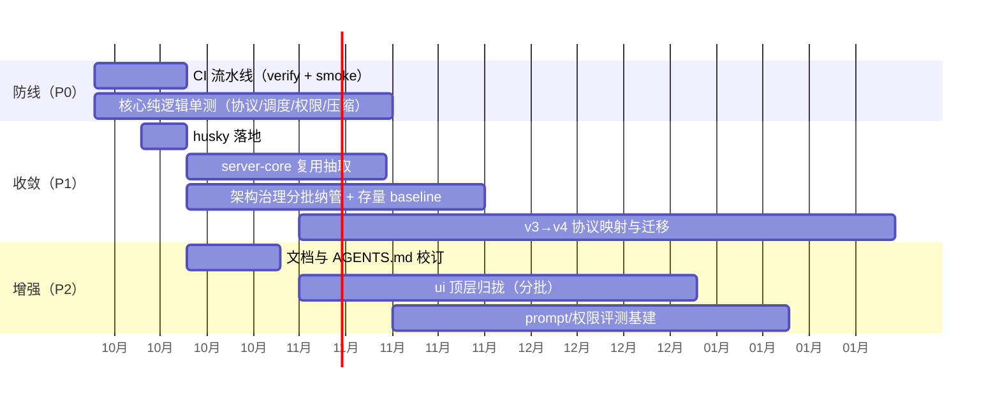

# 05 风险、技术债与路线图

## 1. 风险清单

### R1 工程防线缺失（高，现状事实）

无 CI、6 个测试文件、husky 空。任何一次对上游的 merge（已发生 v3.14.3，未来还会发生）或大规模重构都缺少机械回归网。叠加因素：仓库规模大（桌面 src/main ~149 文件、ui 609 tsx、CLI 16 子包），人工验收覆盖不了。

### R2 Fork 漂移（中，事实 + 推断）

本仓库是上游 ZCode 的开源化分支（`specs/ycode-rebrand.md`：移除官方遥测/内置供应商账号链/强更检查；`specs/merge-main-v3.14.3-into-ycode.md` 记录了 12 个冲突文件）。**推断**：后续上游版本继续演进时，rebrand 删除项（强更、官方遥测、供应商链）在每次 merge 都可能作为"已删除内容"被上游改动重新带入，需要每轮 merge 重新核对——`memory/ycode-opensource-audit.md` 的存在说明团队已意识到此风险。

### R3 双协议与双 server-core 的安全面（中，事实）

`/ws/host` 的 trusted 准入（capability header）在 `packages/server/src/http.ts` 与 `packages/zcode-server-cli/src/server-core/` 各有一份实现；认证中间件（token 保护路径判断）同理。任何一处修复不同步都会造成两个发行形态准入不一致。v3/v4 协议双轨加大了同类风险面。

### R4 远程链路凭据与失败语义（中，待确认）

`memory/ycode-opensource-audit.md` 记录"远程凭据/分享页 401 未处理"。远程 workspace（SSH/WSL/Docker）与分享落地页（fetch 产品服务 `/api/v1`）涉及外部服务鉴权，开源化移除内置账号链后，失败路径的用户体验与错误恢复未闭环。

### R5 平台差异深水区（中，推断）

Windows 是一等目标（`native-search-tools-windows*`、`windows-job-object.ts`、`windowsCuaOperationIndicator`、NSIS 补丁、开发脚本中的"处理 Windows 路径引号"），但 bash sandbox、path 语义、进程管理在三个 OS 上的行为差异需要专门 E2E 才能覆盖——目前无 e2e 目录。

### R6 单点与合规（低-中，事实）

- Apache-2.0 + `third-party/` 合规清单 + NOTICE 齐备，方向良好；但依赖图含 patched 的 ai-sdk 包与内嵌上游组件（`third-party/copied-components.json`），上游升级时 patch 需要重验（视频输入 patch 对 ai-sdk 版本敏感：当前锁定 3.0.81 / 2.0.60）。
- 无 CI 的同时发布脚本（`release-it`、`build:sea`）是本地驱动，版本产物可重复性依赖个人环境。

## 2. 技术债台账

| # | 债务 | 位置 | 偿还动作 |
| --- | --- | --- | --- |
| D1 | 无 CI | `.github/` 缺失 | 04-P0-1 |
| D2 | 测试覆盖 ~0 | 全仓 | 04-P0-2 |
| D3 | server-core 双写 | `zcode-server-cli/src/server-core/` | 04-P1-1 |
| D4 | 治理假覆盖 | `architecture-policy.yaml`（13+ legacy、session entrypoint 不存在） | 04-P1-2 |
| D5 | v3/v4 双协议 | `shared/src/zcode-protocol{,-v4}/`、`bootstrap/src/zcode-protocol{,-v4}/` | 04-P1-3 |
| D6 | husky 空挂 | `.husky/` | 04-P1-4 |
| D7 | ui 顶层平铺 | `packages/ui/src` 100+ 顶层文件 | 04-P2-1 |
| D8 | 文档漂移 | README.md:80、根 AGENTS.md 包清单 | 04-P2-2 |
| D9 | 无评测 | `apps/zcode-cli` | 04-P2-3 |
| D10 | 硬编码平台资源解析多候选链 | `desktopRuntimeEnv.ts:325` `resolveBundledZCodeAgentBinaryPath()` 多候选 + bytecode 双入口 | 待确认后收敛（见下） |

## 3. 待确认问题（不猜测，留给维护者）

1. **上游同步节奏**：Ycode 计划跟随上游 ZCode 到什么程度？决定 D5（v3/v4 收敛）与 R2 的投入级别。
2. **v4 协议是否已覆盖 v3 的全部宿主场景**（尤其手机 `web-remote-replayable` 恢复链路与 automation/bots 域）？决定 04-P1-3 能否启动。
3. **README.md:80 的 oauth 代理**：是文档滞后，还是 `vite.config.ts` 之外另有配置注入？涉及 Web 登录链路是否完整。
4. **`zcode-cua` 的路线**：占位包何时接入真实 Computer Use（当前 fail-closed），还是长期保持占位？影响 `services/src/cua-permission-broker/` 的维护策略。
5. **`packages/formal-proof`** 的定位：是活跃的架构验证工具还是一次性研究产物（目录在 `pnpm-workspace.yaml` 的 `packages/*` 通配下，参与安装与构建）？
6. **发行渠道**：`build:zcode` 发行包与桌面安装包各自的目标用户/分发方式，决定 CI 冒烟需要覆盖的矩阵（OS × 形态）。
7. **遥测端点**：OTel OTLP 导出的目标后端在开源化版本中是否配置（`specs/ycode-rebrand.md` 移除官方遥测后，`telemetry/` 包保留的启用条件）？

## 4. 建议路线图

里程碑判据：

- **M1（+2 周）**：CI 绿灯为合并门槛；协议 v4 wire 往返测试就位。
- **M2（+1.5 月）**：server-core 单一实现；治理新增违规为零（baseline 清零后）。
- **M3（+3 月）**：v3 网关下线或冻结；评测基线可对比 prompt 改动。

## 5. 值得保持的优点（避免"改坏"）

审查不仅记录问题，也应记录**不应被动**的设计：

- 每窗口 Host + attachment + lease/owner 的进程模型（`desktop/src/host/index.ts` 头注释是权威表述），改流/改队列时必须保持 `desktop-continuous` 与 `web-remote-replayable` 双语义验证。
- CLI 子仓"零生产依赖 + 外部 IO 全 adapter"的分层——是 Agent 内核可测试性的根基。
- `IPlatformService` 可选方法区分宿主能力的做法——双宿主复用 609 个组件的关键。
- 权限的 `alwaysAsk` 不可被 hook 覆盖标记、bash 只读 allowlist、webfetch egress guard——安全兜底的骨架。
- 记忆系统（`MEMORY.md` + `memory/`）——跨会话事实沉淀，建议持续使用而非废弃。
