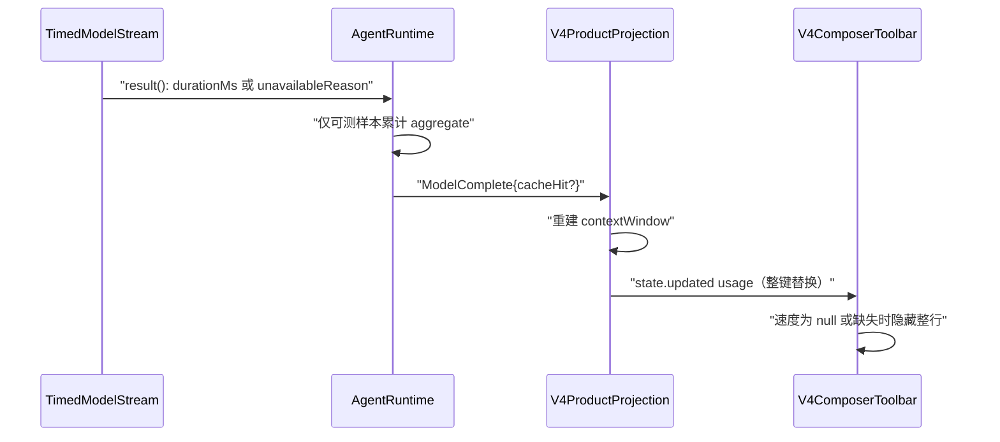

# 平均输出速度：SSH 远程失效与多会话缺失修复设计

## 背景

上下文容量面板的「平均输出速度」（`chat.contextUsage.outputSpeed`）已上线，口径见
[docs/context-cache-hit-rate.md](../../context-cache-hit-rate.md#average-output-speed)。用户反馈两个问题：

1. 连接 SSH 远程工作区后，该行不显示（本地正常）。
2. 多个项目同时开启会话运行时，只有一个会话显示该行。

本文档只修这两个缺陷，不改变速度的计算口径（可测条件、推理口径、累计平均语义保持不变）。

## 当前链路与状态所有者

| 事实                          | 唯一所有者                                                       | 位置                                                                                                                                  |
| ----------------------------- | ---------------------------------------------------------------- | ------------------------------------------------------------------------------------------------------------------------------------- |
| 单次请求生成耗时 / 不可测原因 | 有界 reader `createTimedModelStream`                             | `apps/zcode-cli/packages/core/src/runtime/methods/model-output-timing.ts`                                                             |
| 主轮累计速度                  | 每个 `AgentRuntime` 实例的 `mainTurnCacheHitAggregate`           | `apps/zcode-cli/packages/core/src/runtime/methods/turn-model-step-usage.ts`                                                           |
| 下发载体                      | `ModelComplete.cacheHit.outputTokensPerSecond`（仅 `main_turn`） | `apps/zcode-cli/packages/core/src/runtime/methods/turn-model-step.ts` 633-657                                                         |
| 工具栏展示源                  | v4 快照 `snapshot.usage.contextWindow.cache`                     | `apps/zcode-cli/packages/bootstrap/src/zcode-protocol-v4/product-projection.ts` → `packages/ui/src/v4/composer/V4ComposerToolbar.tsx` |
| 调试诊断                      | CLI session record 内存旁路 `session/debug`                      | `apps/zcode-cli/packages/bootstrap/src/zcode-protocol/session-debug.ts`                                                               |

UI 投影按 session topic（`conversation/${sessionId}`）分桶；一个 workspace 一个 Agent 进程；一个 session 一个
`AgentRuntime`。已核实**不存在**跨会话的全局单槽或共享计时器。

## 根因

### R1 远程：远端 Agent 制品不含该功能（已确认）

- SSH 远端执行的是部署到 `~/.zcode/server/agents/glm/zcode.cjs` 的 bundle，不是本机 Agent。打包版的 GLM 制品来自当前
  App 版本的 CDN manifest（`packages/server/src/remote/zcodeAgentDeploy.ts` `installBundle`，
  见 [docs/remote/zcode-agent-remote-deployment.md](../../remote/zcode-agent-remote-deployment.md)）。
- 证据：仓库 `packages/desktop/mock-cdn/releases/{3.14.0,3.14.3,3.15.1,3.15.5}/glm/linux-x64/zcode.cjs` 全部不含字符串
  `outputTokensPerSecond`。功能提交 `45a475ea`（2026-10-12）之后没有发布对应远端资产。
- 结论：这是发布链路问题，不是协议或投影丢字段。v4 / legacy schema（`zcodeSessionContextCacheUsageSchema`）、
  `parseContextCacheUsageAggregate` 都已保留该字段。

### R2 开发态：`build-desktop-agent-cli.mjs` 复用陈旧 dist（已确认，次要）

`scripts/build-desktop-agent-cli.mjs` 约 111 行：只要 `apps/zcode-cli/packages/cli/dist/zcode.cjs` 存在就直接复用。
当前检出的 dist 与 `packages/desktop/bundled-agents` 停在 2026-10-11，不含速度功能。开发态 SSH 上传的就是这份 dist
（`packages/server/src/remote/zcodeAgentDevDeploy.ts`），本地 dev 也会静默运行旧 Agent。

### R3 多会话：v4 投影在缺 `cacheHit` 时抹掉速度（已确认）

- `product-projection.ts` `onModelComplete`（约 4866-4879 行）每次都整份重建 `contextWindow`，只有 `payload.cacheHit`
  存在时才带 `cache`。`recordMainTurnCacheHitUsage` 在 usage 缺失，或 input/cache 全为 0 时返回 `undefined`，此时主轮
  `ModelComplete` 不带 `cacheHit`。
- compact 成功分支（约 5004-5022 行）重建 `contextWindow` 时同样不带 `cache`。
- `state.updated` 按键整替（`packages/shared/src/zcode-protocol-v4/apply.ts` 129-131 行），所以已显示的速度会被清掉。

### R4 多会话：并发负载下计时被判为 `reader_backpressure`（待验证假设）

- reader 的 read-ahead 上限是 128 事件 / 512 Ki 字符（`model-output-timing.ts` 12-13 行）。缓冲满且 finish 未到时置
  `readBlocked`，该请求不可测。
- 业务消费者逐条 `await emitModelStreamingEvent → appendEvent`（`model-streaming-event.ts`、
  `model-streaming-event-queue.ts` 的 `maybeApplyBackpressure`）。多个 Agent 进程并发写事件时，I/O 与 CPU 竞争使
  消费者变慢，高频小 delta 流更容易撑满 128 条。可能结果：负载下只有最快的那个会话拿到可测样本，其余会话一直是 `null`。
- 目前无法证实：不可测原因只打在 debug 日志 `model.runtime.output_speed.unavailable`（`model.ts` 517-524 行），生产
  环境不落盘，本机也没有这条日志。

### 已接受的既有行为（不修）

冷恢复（重启后打开旧会话、SSH 首次 attach）时，`session-mapper.ts` `contextCacheUsageFromMessages` 不带速度。持久化
消息没有生成耗时，速度计数从 0 开始，要等第一轮可测回答完成才显示。经用户确认，**不持久化生成耗时**。

## 产品规则

1. 同一会话一旦拿到过可测的平均速度，后续主轮 `ModelComplete` 缺 `cacheHit`、或 compact 成功，都**不得**让该行消失；
   下一份带 `cacheHit` 的主轮结果整体覆盖旧值。
2. 不同会话（同进程多 session、不同 workspace 进程）的速度相互独立，互不覆盖。
3. 冷恢复后速度为空，第一轮可测回答完成后显示（保持现状）。
4. 远端 SSH 工作区与本地使用同一 App 版本的 Agent 能力；打包版远端 GLM 制品必须与桌面同 commit 构建。
5. 「为什么没有速度」必须能在不开 debug 日志的情况下诊断：Developer Tools 面板展示当前会话的可测 / 不可测计数和
   最近一次不可测原因。

## 设计

### D1 v4 投影保留 cache（修 R3）

- `onModelComplete`：`payload.cacheHit` 缺失时沿用 `this.snapshot.usage.contextWindow?.cache`（存在才展开）。
- compact 成功分支：重建 `contextWindow` 时保留旧 `cache`；`breakdown` 维持现状不保留（compact 后来源比例已失效）。
- 单一写入方不变：Agent 侧聚合是单调累计的，投影只做「缺失时沿用」，不合成、不推算。
- 修复点写中文注释说明根因（AGENTS 规则）。
- legacy 投影（`packages/ui/src/lib/zcodeSessionProjection.ts`、`packages/services/src/zcode-agent/zcodeTaskServiceAdapter.ts`
  的 fallback 合成 cache）不是工具栏展示源，本次不改。

### D2 不可测原因诊断（为 R4 取证）

不改 `ModelComplete`、不进持久化历史、不进聊天 UI。`RuntimeModelTextResult.outputGenerationUnavailableReason` 的
注释（`core/src/runtime/types.ts` 894 行）同步改为「仅 runtime 内部与 `session/debug` 诊断查询可读」。

- core：`AgentRuntime` 新增内存计数 `outputSpeedDiagnostics`，形状为
  `{ measurableCount: number; unavailableCounts: Partial<Record<Reason, number>>; lastUnavailableReason: Reason | null }`。
  只统计 `main_turn`，在 `turn-model-step.ts` 调 `recordMainTurnCacheHitUsage` 的同一位置更新；对外暴露只读
  `getOutputSpeedDiagnostics()`（加到 `AgentRuntimeInternal` / 公共 runtime 接口）。resume / rewind 时与速度计数一起清零。
- bootstrap：`readSessionDebug(record)` 从 `record.app.runtime.getOutputSpeedDiagnostics()` 读取，放进快照新增字段
  `outputSpeed`。`SessionRecord` 局部类型扩展为
  `{ app: { sessionId: string; runtime?: { getOutputSpeedDiagnostics(): OutputSpeedDiagnostics } } }`；runtime 缺失
  （现有单测的轻量 record）时不输出该字段。
- shared：`sessionDebugSnapshotSchema` 新增 `outputSpeed`（strict 对象，`.optional()`），原因枚举复用 core 的 6 个值
  （在 shared 定义常量数组，core 类型保持一致）。
- UI：`packages/ui/src/DeveloperToolsPane.tsx` 汇总区展示「可测 N / 不可测 M（最近原因：xxx）」，文案走 i18n
  （`zh-CN.ts` / `en-US.ts`），原因用可读文案映射。
- 版本偏斜：desktop 用 strict schema 解析 `session/debug`（`zcodeAgentService.ts` 约 4093 行）。新 Agent 配旧桌面会
  解析失败，但该接口只服务 Developer Tools，且桌面与 Agent 同版本发布（R1 修好后远端也同版本），可以接受；在文档中注明。

### D3 计时缓冲上限（修 R4，**取证后**再落地）

- 若 D2 证实多会话下的主因是 `reader_backpressure`：把 `MAX_BUFFERED_EVENTS` 从 128 调到 1024，保留
  `MAX_BUFFERED_CHARACTERS = 512 Ki` 作为内存上限；同步更新文档中的「128 events」。
- 若主因是 `unaligned_reasoning` / `invalid_usage` 等口径问题：停下与用户对齐，不在本次扩大可测口径。

### D4 发布与开发态制品一致性（修 R1、R2）

- R1（流程）：发布桌面版时，必须用同一 commit 执行远端资产构建（`pnpm --filter @zcode/desktop prepare:remote-assets`，
  即 `scripts/prepare-prebuilds.mjs`），再把 linux/darwin 的 GLM 制品和 manifest 发布到该 App 版本读取的 CDN。本地联调
  可在开发态用 mock-cdn 或 dev 上传路径（`ZCODE_RUNTIME_ENV=development` 时上传本地 dist）。在
  `docs/remote/zcode-agent-remote-deployment.md` 补一节「发布前置条件」。
- R2（代码）：`build-desktop-agent-cli.mjs` 的复用条件从「dist 存在」改为「dist 存在且不旧于 CLI 源码」。比较对象是
  `apps/zcode-cli/packages/*/src/**` 最新 mtime 与 `dist/zcode.cjs` mtime，用异步 fs 递归，跳过 `node_modules`。
  源码更新时走完整重建，并打印一行说明原因的日志。

## 验收场景

1. 主轮 A 带 `cacheHit.outputTokensPerSecond=40`，随后主轮 B 不带 `cacheHit`：快照仍是 40。
2. 有速度后 compact 成功：`usedTokens` 回落，`cache.outputTokensPerSecond` 仍为 40，`breakdown` 被清除。
3. 主轮 C 带新的 `cacheHit`（速度 55）：整体覆盖为 55。
4. sidecar（title、compact、subagent）的 `ModelComplete` 不改变主会话 cache（既有行为回归）。
5. 同一进程两个 session 交替完成主轮：两者的 `outputTokensPerSecond` 各自独立。
6. `session/debug`：可测请求 `measurableCount+1`；背压请求 `unavailableCounts.reader_backpressure+1`，
   `lastUnavailableReason="reader_backpressure"`；resume 后清零；sidecar 不计入。
7. Developer Tools 面板在桌面与手机宽度、深浅主题、中英文下展示上述诊断。
8. （D3 落地时）同等条件下 300 条小 delta、消费者短暂变慢但未撑满 1024 条时仍可测；超出上限时仍判为
   `reader_backpressure`。
9. （D4/R2）源码比 dist 新时，`build-desktop-agent-cli.mjs` 重建；dist 不旧时复用。
10. （D4/R1 手工）SSH 远端 `grep -c outputTokensPerSecond ~/.zcode/server/agents/glm/zcode.cjs` 大于 0；完成一轮可测
    回答后面板显示速度。

## 不做

- 不持久化生成耗时、不改消息存储结构、不做 migration。
- 不改速度口径与可测判定（除 D3 的缓冲上限）。
- 不改 legacy 投影、手机 `web-remote-replayable` 链路语义（两条链路都读同一份 v4 快照，D1 同时生效）。
- 不提升 `model.runtime.output_speed.unavailable` 日志等级。
